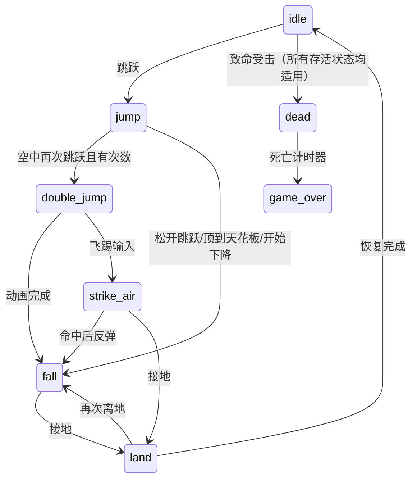

# Soma 状态与场景生命周期校验

## 检查结论

当前实际注册 **27 个状态**：26 个存活状态，以及 `dead` 死亡终态。归档前审核确认转移目标和角色动画名均能解析，222 个角色动画资源路径均存在。生成的静态检查表和机器可读报告已随测试文件清理，本说明保留审核结论与运行规则。

`Soma_Skill_Ground`、`Soma_Skill_Air` 是未注册的历史实现；实际红魂使用 `using_axe_bullet_on_ground / using_axe_bullet_in_air`。历史实现不计入当前运行时状态数量。

运行检查覆盖所有 26 个存活状态在动画完成或落地后的恢复、16 类地面动作离地、全部 27 个状态的死亡中断、普通受击与霸体、地面/下蹲/空中的三种武器攻击入口、超级攻击扣费、二段跳、空中施法和死亡计时器。

稳定状态允许等待输入；`fall` 允许等待地面碰撞；`strike_air` 等待落地或命中；黑豹允许持续按键。它们的停留是预期行为。`dead` 通过 1.5 秒死亡计时器进入 `game_over`，不返回存活动作。

## 下落高度与动画

**空中下落使用单一的 `fall` 动画，按动画时间播放；高度分档用于落地反应。** 现有素材没有注册“小/中/大高度空中下落”三个独立状态，本次保留这一规则。

| 落地来源 | 高度条件（像素） | 动画/行为 |
|---|---|---|
| 普通下落 | `< 100` | `land_small_height` |
| 普通下落 | `100 ≤ 高度 ≤ 300` | `land_medium_height` |
| 普通下落 | `> 300` | `land_large_height`，等待硬直结束 |
| 空中受击后直接落地 | 任意 | `land_large_height`，保留受击反应 |
| 竖直飞踢 | `≤ 250` | 使用原小/中落地规则 |
| 竖直飞踢 | `> 250` | `land_large_height` |
| 斜向飞踢 | `≤ 250` | `walk_stop` |
| 斜向飞踢 | `> 250` | `land_diagonal` |
| 空中大剑攻击接地 | 攻击尚未完成 | 衔接地面大剑动作，保留原攻击延续规则 |

高度按碰撞修正后的实际竖直位移累计，包含接地当帧；重新上升（二段跳、受击上抛、飞踢反弹）会清除之前的下落距离。进入房间后同步碰撞体与位置历史，传送距离不计入落地高度。

验证既覆盖直接的 100/300、250 像素边界，也使用真实逐步碰撞物理从 99/100/300/301 像素落到实体地面，确认落地高度与动画一致。

## 已修复的问题

- 地面攻击、下蹲、技能、落地等动作离地后由统一仲裁切换到 `fall`；地面受击离地进入 `hit_air`。
- 新增死亡状态，致命受击优先于霸体和普通请求，存活状态入口拒绝死亡后的动作请求。
- 清除起跳/穿平台时残留的 `JustLanded`，避免刚离地又错误进入落地状态。
- 上升期间可触发二段跳，次数不足时拒绝进入；空中红魂使用 SPACE 的释放判定，不再错误依赖 K。
- 黑豹在 K 不再按住时恢复普通状态，覆盖没有收到单独抬键事件的情况。
- 滑铲与黑豹退出时恢复进入前的攻击力，取消把角色攻击力固定覆盖为 5 的行为。
- 修正动画单帧/最后一帧时长与索引，空动画和缺失动画安全停止，暂停动画不推进时间。
- 未知 FSM 目标不再插入空状态，拒绝无效请求时保留已有合法请求。
- 初始 idle 立即播放待机动画，同时保留从落地状态恢复时允许原动画继续播放的行为。

## 切换场景的清理规则

子弹、敌方飞剑、残影与短时特效使用 `SetDestroyOnSceneExit()` 标记。场景退出完成、新场景进入之前，管理器取消已合并和待初始化的临时对象；附属碰撞体通过父对象的 `OnDestroy` 一起取消。对象立即退出更新、碰撞、绘制和调试绘制，并按管理器原有的延迟销毁流程释放。

两套浮动数字池在有效切场景时清空并重置复用，不销毁共用纹理。重复进入同一房间、Push/Pop 场景也执行清理；无效场景请求不清理。菜单使用 MenuStack，暂停只冻结/隐藏数字，关闭菜单仍可继续动画。

## 历史验证

归档前使用四种配置的无窗口回归和静态状态审核脚本执行检查；测试入口、脚本和生成报告已按归档要求清理。

2026-10-28 验证结果：x64 / x86 的 Debug、Release 四种配置均构建通过，各自 44 组回归全部通过；静态审核覆盖 27 个注册状态、222 个动画资源路径，错误数为 0。

自动化使用真实状态类和 FSM，以不依赖纹理的动画时钟控制完成事件；物理落地用例使用真实碰撞代码。检查没有穷举所有输入时序，也没有执行完整人工试玩或画面比对。
